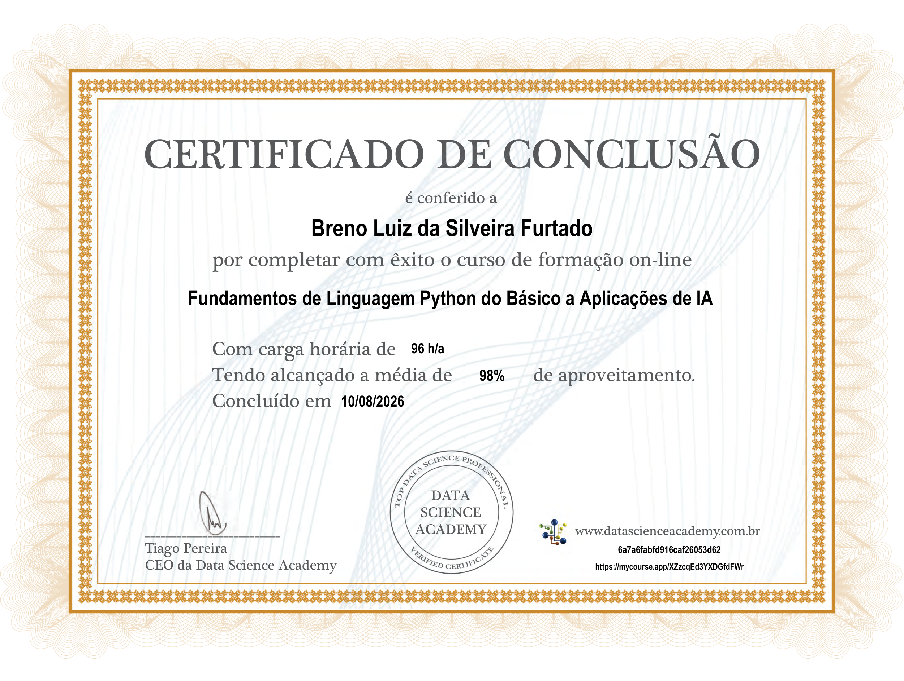
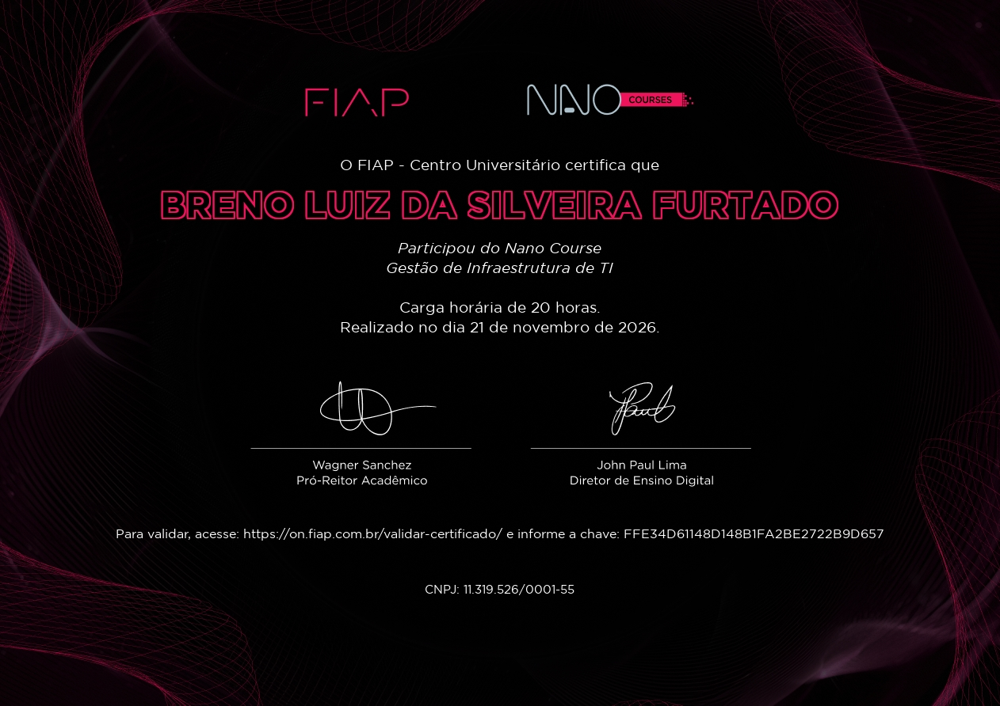
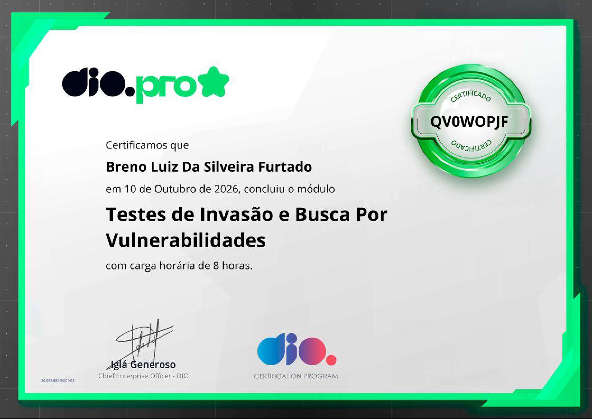
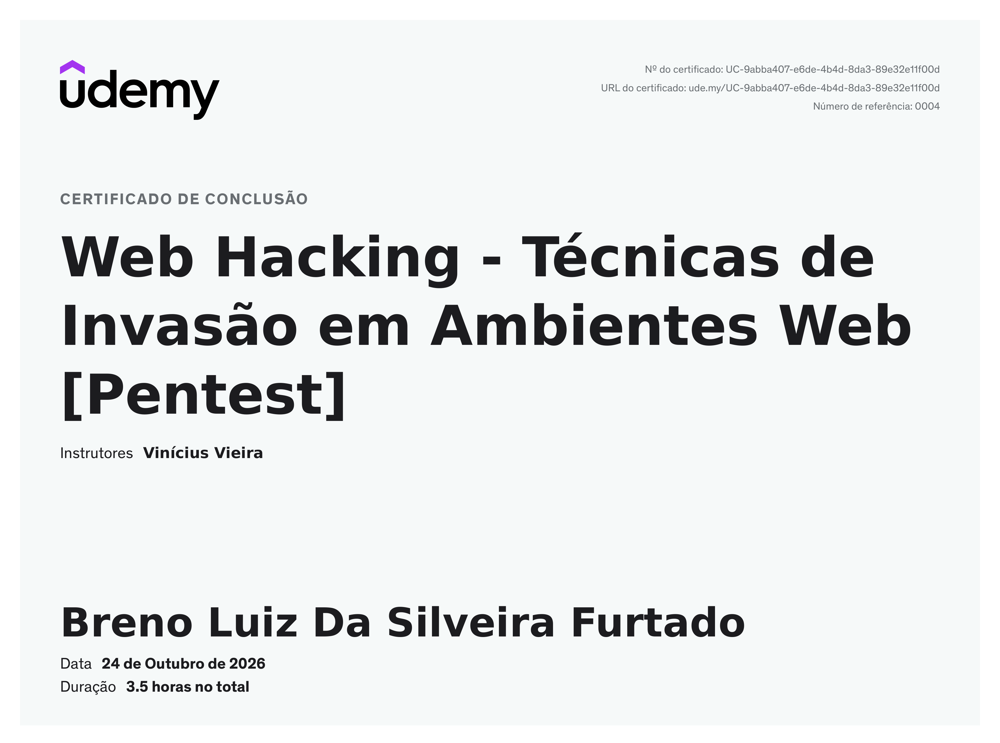

# 🎓 Certificados — Breno Luiz da Silveira Furtado

Registro dos cursos, módulos e formações que concluí, com foco em **Python** e **Cibersegurança**. Cada certificado tem imagem para consulta rápida e, quando disponível, o PDF original.

## 📊 Resumo

| Indicador | Valor |
|---|---|
| Certificados de conclusão | **46** |
| Carga horária certificada | **282 h** |
| Carga horária sem os certificados de módulo | **261 h** |
| Instituições emissoras | **5** |
| Período | 07/08/2026 a 21/11/2026 |

> A carga horária é a informada em cada certificado. Os 3 certificados de módulo (21 h) reúnem conteúdo de cursos que também têm certificado próprio, por isso o total também aparece sem eles.

## 🧭 Carga horária por área

| Área | Certificados | Carga horária | Participação |
|---|---:|---:|---:|
| 🐍 Python | 20 | 213 h | 75,5% |
| 🔐 Cibersegurança | 15 | 33,5 h | 11,9% |
| 🖥️ Infraestrutura e Suporte | 2 | 22,5 h | 8,0% |
| 💻 Desenvolvimento Web e Java | 6 | 7 h | 2,5% |
| 🚀 Automação e Carreira | 3 | 6 h | 2,1% |
| **Total** | **46** | **282 h** | **100%** |

## 🏫 Carga horária por instituição

| Instituição | Certificados | Carga horária |
|---|---:|---:|
| Data Science Academy | 2 | 160 h |
| DIO | 40 | 76 h |
| Enap | 1 | 20 h |
| FIAP | 1 | 20 h |
| Udemy | 2 | 6 h |

## 📅 Evolução mensal (2026)

| Mês de conclusão | Certificados | Carga horária | Acumulado |
|---|---:|---:|---:|
| Agosto | 7 | 184 h | 184 h |
| Setembro | 20 | 38 h | 222 h |
| Outubro | 11 | 27,5 h | 249,5 h |
| Novembro | 8 | 32,5 h | 282 h |

## ⭐ Destaques

<p>
  <a href="imagens/07_2026-08-10_dsa_python-basico-aplicacoes-ia.png"></a>
  <a href="imagens/46_2026-11-21_fiap_gestao-infraestrutura-ti.png"></a>
  <a href="imagens/37_2026-10-10_dio_modulo-pentest-vulnerabilidades.png"></a>
  <a href="imagens/38_2026-10-24_udemy_web-hacking-pentest.png"></a>
</p>

## 📚 Certificados por área

A numeração segue a ordem de conclusão.

### 🐍 Python — 20 certificados · 213 h

| Nº | Conclusão | Certificado | Instituição | Carga | Código de validação | Arquivos |
|---:|---|---|---|---:|---|---|
| 05 | 09/08/2026 | Fundamentos de Linguagem Python Para Análise de Dados, Data Science e Machine Learning | Data Science Academy | 64 h | [`6a7929593d4dfff51c012d68`](https://mycourse.app/YAB2AfTqGrPV15mCW) | [PNG](imagens/05_2026-08-09_dsa_python-analise-de-dados-machine-learning.png) · [PDF](pdfs/05_2026-08-09_dsa_python-analise-de-dados-machine-learning.pdf) |
| 06 | 10/08/2026 | Aprendendo com Python | Enap | 20 h | `cb89413e-06a4-405e-90e4-910217b48907` | [PNG 1](imagens/06_2026-08-10_enap_aprendendo-com-python_p1.png) · [PNG 2](imagens/06_2026-08-10_enap_aprendendo-com-python_p2.png) · [PDF](pdfs/06_2026-08-10_enap_aprendendo-com-python.pdf) |
| 07 | 10/08/2026 | Fundamentos de Linguagem Python do Básico a Aplicações de IA | Data Science Academy | 96 h | [`6a7a6fabfd916caf26053d62`](https://mycourse.app/XZzcqEd3YXDGfdFWr) | [PNG](imagens/07_2026-08-10_dsa_python-basico-aplicacoes-ia.png) · [PDF](pdfs/07_2026-08-10_dsa_python-basico-aplicacoes-ia.pdf) |
| 08 | 10/09/2026 | Introdução à Programação com Python | DIO | 8 h | `OVV8CWEG` | [PNG](imagens/08_2026-09-10_dio_introducao-programacao-python.png) · [PDF](pdfs/08_2026-09-10_dio_introducao-programacao-python.pdf) |
| 09 | 11/09/2026 | Conhecendo a Linguagem de Programação Python | DIO | 2 h | `IOKONUJQ` | [PNG](imagens/09_2026-09-11_dio_conhecendo-linguagem-python.png) · [PDF](pdfs/09_2026-09-11_dio_conhecendo-linguagem-python.pdf) |
| 10 | 11/09/2026 | Introdução à Programação Orientada a Objetos (POO) com Python | DIO | 1 h | `GKFQZNHE` | [PNG](imagens/10_2026-09-11_dio_introducao-poo-python.png) · [PDF](pdfs/10_2026-09-11_dio_introducao-poo-python.pdf) |
| 11 | 14/09/2026 | Aplicando Encapsulamento em Python | DIO | 1 h | `WF66J8TI` | [PNG](imagens/11_2026-09-14_dio_encapsulamento-python.png) · [PDF](pdfs/11_2026-09-14_dio_encapsulamento-python.pdf) |
| 12 | 14/09/2026 | Dominando Funções Python | DIO | 1 h | `WNXNLWAQ` | [PNG](imagens/12_2026-09-14_dio_funcoes-python.png) · [PDF](pdfs/12_2026-09-14_dio_funcoes-python.pdf) |
| 13 | 15/09/2026 | Tipos de Operadores com Python | DIO | 2 h | `GC2YP8I4` | [PNG](imagens/13_2026-09-15_dio_operadores-python.png) · [PDF](pdfs/13_2026-09-15_dio_operadores-python.pdf) |
| 15 | 16/09/2026 | Manipulando Strings com Python | DIO | 2 h | `RNJ7RAFV` | [PNG](imagens/15_2026-09-16_dio_strings-python.png) · [PDF](pdfs/15_2026-09-16_dio_strings-python.pdf) |
| 16 | 16/09/2026 | Estruturas Condicionais e de Repetição em Python | DIO | 2 h | `IFX7FTFS` | [PNG](imagens/16_2026-09-16_dio_condicionais-repeticao-python.png) · [PDF](pdfs/16_2026-09-16_dio_condicionais-repeticao-python.pdf) |
| 17 | 17/09/2026 | Trabalhando com Listas em Python | DIO | 1 h | `JSBY3YHH` | [PNG](imagens/17_2026-09-17_dio_listas-python.png) · [PDF](pdfs/17_2026-09-17_dio_listas-python.pdf) |
| 18 | 18/09/2026 | Aprendendo o Conceito de Herança com Python | DIO | 1 h | `NQX0UGUK` | [PNG](imagens/18_2026-09-18_dio_heranca-python.png) · [PDF](pdfs/18_2026-09-18_dio_heranca-python.pdf) |
| 19 | 18/09/2026 | Ambiente de Desenvolvimento e Primeiros Passos com Python | DIO | 1 h | `4O1XOTB8` | [PNG](imagens/19_2026-09-18_dio_ambiente-primeiros-passos-python.png) · [PDF](pdfs/19_2026-09-18_dio_ambiente-primeiros-passos-python.pdf) |
| 20 | 18/09/2026 | Conhecendo Tuplas em Python | DIO | 1 h | `GQ9NKN2N` | [PNG](imagens/20_2026-09-18_dio_tuplas-python.png) |
| 21 | 21/09/2026 | Explorando Conjuntos em Python | DIO | 1 h | `GBH5JLJ6` | [PNG](imagens/21_2026-09-21_dio_conjuntos-python.png) |
| 22 | 21/09/2026 | Aprendendo a Utilizar Dicionários em Python | DIO | 1 h | `I7O0S2EU` | [PNG](imagens/22_2026-09-21_dio_dicionarios-python.png) |
| 23 | 22/09/2026 | Aprendendo Estruturas de Dados com Python *(módulo)* | DIO | 6 h | `IRBHBD8C` | [PNG](imagens/23_2026-09-22_dio_modulo-estruturas-de-dados-python.png) |
| 24 | 22/09/2026 | Conhecendo Polimorfismo em Python | DIO | 1 h | `CKGSCPWF` | [PNG](imagens/24_2026-09-22_dio_polimorfismo-python.png) · [PDF](pdfs/24_2026-09-22_dio_polimorfismo-python.pdf) |
| 25 | 24/09/2026 | Interfaces e Classes Abstratas com Python | DIO | 1 h | `MHT1SFX2` | [PNG](imagens/25_2026-09-24_dio_interfaces-classes-abstratas-python.png) · [PDF](pdfs/25_2026-09-24_dio_interfaces-classes-abstratas-python.pdf) |

### 🔐 Cibersegurança — 15 certificados · 33,5 h

| Nº | Conclusão | Certificado | Instituição | Carga | Código de validação | Arquivos |
|---:|---|---|---|---:|---|---|
| 14 | 15/09/2026 | Conhecendo a Formação de Cibersegurança | DIO | 1 h | `LPW1Q40U` | [PNG](imagens/14_2026-09-15_dio_formacao-ciberseguranca.png) · [PDF](pdfs/14_2026-09-15_dio_formacao-ciberseguranca.pdf) |
| 26 | 24/09/2026 | Princípios da Cibersegurança | DIO | 2 h | `AYLVGPSE` | [PNG](imagens/26_2026-09-24_dio_principios-ciberseguranca.png) · [PDF](pdfs/26_2026-09-24_dio_principios-ciberseguranca.pdf) |
| 27 | 24/09/2026 | Conceitos e Práticas de Sistemas Operacionais e Máquinas Virtuais | DIO | 2 h | `KUCKP9L2` | [PNG](imagens/27_2026-09-24_dio_sistemas-operacionais-maquinas-virtuais.png) · [PDF](pdfs/27_2026-09-24_dio_sistemas-operacionais-maquinas-virtuais.pdf) |
| 28 | 05/10/2026 | Introdução à Deep Web e Anonimato | DIO | 1 h | `TPUXJPBR` | [PNG](imagens/28_2026-10-05_dio_deep-web-anonimato.png) · [PDF](pdfs/28_2026-10-05_dio_deep-web-anonimato.pdf) |
| 29 | 05/10/2026 | Materiais Complementares: Fundamentos de Cibersegurança | DIO | 1 h | `VPINLMWD` | [PNG](imagens/29_2026-10-05_dio_materiais-fundamentos-ciberseguranca.png) · [PDF](pdfs/29_2026-10-05_dio_materiais-fundamentos-ciberseguranca.pdf) |
| 30 | 05/10/2026 | Fundamentos de Cibersegurança *(módulo)* | DIO | 7 h | `PJM5WAEQ` | [PNG](imagens/30_2026-10-05_dio_modulo-fundamentos-ciberseguranca.png) · [PDF](pdfs/30_2026-10-05_dio_modulo-fundamentos-ciberseguranca.pdf) |
| 31 | 06/10/2026 | Fundamentos de Testes de Invasão (Pentest) | DIO | 1 h | `QLGQU1UK` | [PNG](imagens/31_2026-10-06_dio_fundamentos-pentest.png) · [PDF](pdfs/31_2026-10-06_dio_fundamentos-pentest.pdf) |
| 32 | 06/10/2026 | Introdução à Coleta e Análise de Segurança Cibernética | DIO | 2 h | `EP6GFQLF` | [PNG](imagens/32_2026-10-06_dio_coleta-analise-seguranca.png) · [PDF](pdfs/32_2026-10-06_dio_coleta-analise-seguranca.pdf) |
| 33 | 07/10/2026 | Tópicos em Engenharia Social | DIO | 1 h | `4KFB2SYC` | [PNG](imagens/33_2026-10-07_dio_engenharia-social.png) · [PDF](pdfs/33_2026-10-07_dio_engenharia-social.pdf) |
| 34 | 08/10/2026 | Conceitos e Técnicas de Varredura de Rede | DIO | 1 h | `ONKKKZJG` | [PNG](imagens/34_2026-10-08_dio_varredura-de-rede.png) · [PDF](pdfs/34_2026-10-08_dio_varredura-de-rede.pdf) |
| 35 | 09/10/2026 | Princípios de Enumeração e Exploração de Vulnerabilidades | DIO | 1 h | `NQRZG1IA` | [PNG](imagens/35_2026-10-09_dio_enumeracao-exploracao-vulnerabilidades.png) · [PDF](pdfs/35_2026-10-09_dio_enumeracao-exploracao-vulnerabilidades.pdf) |
| 36 | 10/10/2026 | Materiais Complementares: Pentest e Busca de Vulnerabilidades | DIO | 1 h | `XQ2K4VCA` | [PNG](imagens/36_2026-10-10_dio_materiais-pentest-vulnerabilidades.png) · [PDF](pdfs/36_2026-10-10_dio_materiais-pentest-vulnerabilidades.pdf) |
| 37 | 10/10/2026 | Testes de Invasão e Busca por Vulnerabilidades *(módulo)* | DIO | 8 h | `QV0WOPJF` | [PNG](imagens/37_2026-10-10_dio_modulo-pentest-vulnerabilidades.png) · [PDF](pdfs/37_2026-10-10_dio_modulo-pentest-vulnerabilidades.pdf) |
| 38 | 24/10/2026 | Web Hacking - Técnicas de Invasão em Ambientes Web \[Pentest\] | Udemy | 3,5 h | [`UC-9abba407-e6de-4b4d-8da3-89e32e11f00d`](https://ude.my/UC-9abba407-e6de-4b4d-8da3-89e32e11f00d) | [PNG](imagens/38_2026-10-24_udemy_web-hacking-pentest.png) · [PDF](pdfs/38_2026-10-24_udemy_web-hacking-pentest.pdf) |
| 45 | 17/11/2026 | Boas vindas ao Bootcamp AWS - Cibersegurança | DIO | 1 h | `EIKRMUJC` | [PNG](imagens/45_2026-11-17_dio_boas-vindas-aws-ciberseguranca.png) · [PDF](pdfs/45_2026-11-17_dio_boas-vindas-aws-ciberseguranca.pdf) |

### 💻 Desenvolvimento Web e Java — 6 certificados · 7 h

| Nº | Conclusão | Certificado | Instituição | Carga | Código de validação | Arquivos |
|---:|---|---|---|---:|---|---|
| 02 | 07/08/2026 | Introdução à Plataforma Java | DIO | 1 h | `C5WHG4XK` | [PNG](imagens/02_2026-08-07_dio_introducao-plataforma-java.png) · [PDF](pdfs/02_2026-08-07_dio_introducao-plataforma-java.pdf) |
| 03 | 07/08/2026 | Ambiente de Desenvolvimento Java | DIO | 1 h | `NROWPETH` | [PNG](imagens/03_2026-08-07_dio_ambiente-desenvolvimento-java.png) · [PDF](pdfs/03_2026-08-07_dio_ambiente-desenvolvimento-java.pdf) |
| 41 | 14/11/2026 | Boas-vindas ao Bootcamp LocalizaLabs React Developer | DIO | 1 h | `PMLEWKWQ` | [PNG](imagens/41_2026-11-14_dio_boas-vindas-localizalabs-react.png) · [PDF](pdfs/41_2026-11-14_dio_boas-vindas-localizalabs-react.pdf) |
| 42 | 15/11/2026 | Configuração de Ambiente React | DIO | 1 h | `PNPWTU4B` | [PNG](imagens/42_2026-11-15_dio_configuracao-ambiente-react.png) · [PDF](pdfs/42_2026-11-15_dio_configuracao-ambiente-react.pdf) |
| 43 | 15/11/2026 | Páginas Web com HTML | DIO | 2 h | `9XWFUCEI` | [PNG](imagens/43_2026-11-15_dio_paginas-web-html.png) · [PDF](pdfs/43_2026-11-15_dio_paginas-web-html.pdf) |
| 44 | 15/11/2026 | Estilizando Páginas com CSS | DIO | 1 h | `8WJSXHZQ` | [PNG](imagens/44_2026-11-15_dio_estilizando-paginas-css.png) · [PDF](pdfs/44_2026-11-15_dio_estilizando-paginas-css.pdf) |

### 🖥️ Infraestrutura e Suporte — 2 certificados · 22,5 h

| Nº | Conclusão | Certificado | Instituição | Carga | Código de validação | Arquivos |
|---:|---|---|---|---:|---|---|
| 39 | 08/11/2026 | Analista de Suporte N1: Do Zero ao Primeiro Emprego (Prático) | Udemy | 2,5 h | [`UC-c52decf5-932a-4ea8-86a5-d70f3dd45260`](https://ude.my/UC-c52decf5-932a-4ea8-86a5-d70f3dd45260) | [PNG](imagens/39_2026-11-08_udemy_analista-suporte-n1.png) · [PDF](pdfs/39_2026-11-08_udemy_analista-suporte-n1.pdf) |
| 46 | 21/11/2026 | Gestão de Infraestrutura de TI *(nano course)* | FIAP | 20 h | `FFE34D61148D148B1FA2BE2722B9D657` | [PNG](imagens/46_2026-11-21_fiap_gestao-infraestrutura-ti.png) · [PDF](pdfs/46_2026-11-21_fiap_gestao-infraestrutura-ti.pdf) |

### 🚀 Automação e Carreira — 3 certificados · 6 h

| Nº | Conclusão | Certificado | Instituição | Carga | Código de validação | Arquivos |
|---:|---|---|---|---:|---|---|
| 01 | 07/08/2026 | Boas vindas à Aceleração Santander - Automação na Prática | DIO | 1 h | `6VXXUFNM` | [PNG](imagens/01_2026-08-07_dio_boas-vindas-santander-automacao.png) · [PDF](pdfs/01_2026-08-07_dio_boas-vindas-santander-automacao.pdf) |
| 04 | 07/08/2026 | Introdução a Experiência Decola Tech (Avanade) | DIO | 1 h | `BGFBGFXC` | [PNG](imagens/04_2026-08-07_dio_introducao-decola-tech-avanade.png) |
| 40 | 13/11/2026 | Atalho Secreto - Conquiste sua próxima Vaga nas maiores Empresas de Tecnologia | DIO | 4 h | `8QCNNBZW` | [PNG](imagens/40_2026-11-13_dio_atalho-secreto-vagas-tecnologia.png) · [PDF](pdfs/40_2026-11-13_dio_atalho-secreto-vagas-tecnologia.pdf) |

## 📎 Outros comprovantes

Não entram na contagem acima, pois não são certificados de conclusão.

- Santander Open Academy — concessão de vaga no curso *Santander Automação com N8N na prática*: [PNG](imagens/outros/santander-open-academy_vaga-automacao-n8n.png)

## ✅ Como validar

| Instituição | Como conferir |
|---|---|
| DIO | Código impresso no selo do certificado |
| Data Science Academy | Link no código de validação da tabela |
| Udemy | Link no código de validação da tabela |
| Enap | Informar o código em [escolavirtual.gov.br/documentos/validacao](https://www.escolavirtual.gov.br/documentos/validacao) |
| FIAP | Informar a chave em [on.fiap.com.br/validar-certificado](https://on.fiap.com.br/validar-certificado/) |

## 🗂️ Organização do repositório

```text
.
├── imagens/          # certificados em PNG
│   └── outros/       # comprovantes que não são de conclusão
└── pdfs/             # PDFs originais, com o mesmo nome das imagens
```

Padrão de nome: `NN_AAAA-MM-DD_instituicao_titulo.ext`

- `NN`: ordem de conclusão;
- `AAAA-MM-DD`: data de conclusão;
- `instituicao`: `dio`, `dsa` (Data Science Academy), `enap`, `udemy` ou `fiap`;
- `titulo`: nome curto em minúsculas, sem acentos, separado por hífens;
- `_p1`, `_p2`: páginas de um mesmo certificado.

Os certificados 04, 20, 21, 22, 23 estão disponíveis somente em PNG.
